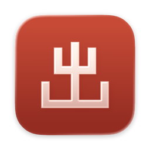
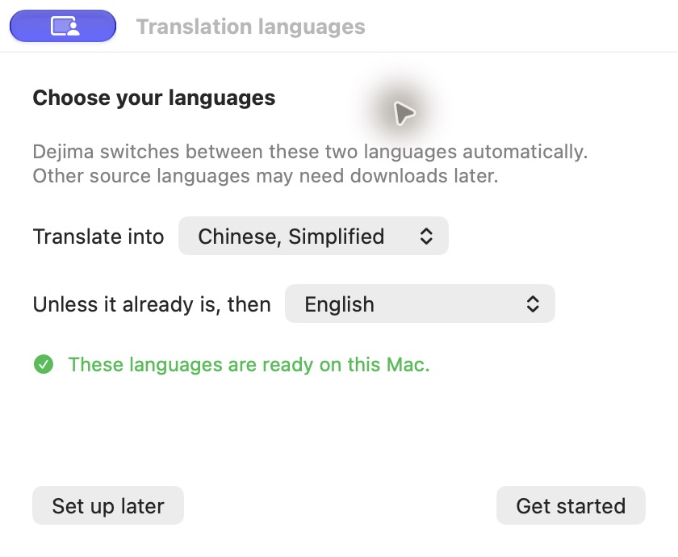

# Dejima

**Mac에서 로컬 번역. ⌘C를 두 번 누르세요.**

텍스트를 선택하고 ⌘C를 빠르게 두 번 누르면 포인터 옆에 번역문이 표시됩니다. Dejima는 앱의 오른쪽 클릭 번역 메뉴에 의존하지 않으며, 다른 앱으로 전환할 필요도 없습니다. 필요한 모델이 준비되면 오프라인으로 사용할 수 있습니다.

[简体中文](README.md) · [English](README.en.md) · [日本語](README.ja.md)

*Dejima v0.2.8, 영어 인터페이스.*

**[Dejima 다운로드](https://github.com/AIChemist-Nuki/dejima/releases/latest)** · macOS 15 이상

## 세 단계로 시작하기

### 1. 설치하고 권한 허용하기

내려받은 DMG를 열고 `Dejima.app`을 응용 프로그램 폴더로 드래그한 뒤 실행하세요.

앱의 안내에 따라 시스템 설정의 손쉬운 사용 목록을 엽니다. Dejima를 목록에 드래그하고 권한을 켜세요. 권한을 허용하면 언어 선택 단계로 이어집니다.

### 2. 번역할 언어 선택하기

안내 창에서 다음 두 가지를 설정하세요.

- **번역할 언어**: 평소 번역 결과를 읽을 언어입니다.
- **이미 그 언어라면**: 원문이 위에서 선택한 언어와 같을 때 사용할 다른 번역 대상 언어입니다.

둘 다 번역 결과의 언어를 정하는 설정이며, 원문의 언어는 자동으로 감지합니다. 예를 들어 **번역할 언어**에서 중국어 간체를, **이미 그 언어라면**에서 영어를 선택하면 **영어 → 중국어, 중국어 → 영어**로 번역합니다.

기본값은 중국어 간체와 일본어입니다. 필요에 맞게 변경하세요. 나중에 화면 위쪽 메뉴 막대의 Dejima 아이콘에서도 변경할 수 있습니다.

안내 창에서 선택한 언어를 사용할 준비가 되었는지 확인합니다. Apple Intelligence 모델 등 사용할 수 있는 모델이 이미 있다면 추가로 내려받을 필요가 없습니다. 필요한 경우 **언어 다운로드**를 누르고 시스템 안내를 따르세요. 언어가 준비되었다고 확인되면 **시작하기**를 눌러 안내 창을 닫습니다.

*언어 설정 화면, 영어 인터페이스.*

### 3. 선택하고, ⌘C, ⌘C

웹페이지나 문서에서 복사할 수 있는 글을 선택하고, ⌘를 누른 채 C를 빠르게 두 번 누릅니다. 포인터 옆에 번역문이 나타납니다. 패널 바깥을 클릭하거나 Esc를 누르면 계속 읽을 수 있습니다.

**언어 모델이 없다는 메시지가 표시되면**

이미 번역이 된다면 이 과정은 건너뛰세요. 최신 시스템에서는 이미 준비된 Apple Intelligence 모델을 사용할 수 있습니다. 시스템의 다운로드 안내가 나타나면 그 안내를 따르면 됩니다.

1. Dejima 메뉴에서 **번역 언어 설정**을 누르면 **Translation Languages…**가 바로 열립니다. **Language & Region**만 열리면 그 안에서 **Translation Languages…**를 클릭하세요. 설정을 열기만 해서는 다운로드가 시작되지 않습니다.
2. 오류 메시지에 표시된 원문과 번역문 언어의 **Download** 버튼을 눌러 **둘 다** 내려받습니다. 예를 들어 영어와 중국어 간체입니다.
3. 다운로드가 끝나면 원래 글로 돌아가 ⌘C를 두 번 누릅니다.

*시스템의 번역 언어 다운로드 목록입니다. 영어 인터페이스로 표시됩니다.*

Dejima는 [이미 기기에서 번역을 처리하므로](https://developer.apple.com/documentation/translation/translationsession), 스크린샷의 **On-Device Mode**를 켤 필요가 없습니다. 이 시스템 설정은 Dejima의 Apple Intelligence 추가 다듬기와 별개입니다.

## 편하게 사용하기

- **언어 감지.** 짧은 텍스트는 원문의 언어를 잘못 감지할 수 있습니다.
- **복사와 고정.** 복사 버튼으로 번역문을 복사합니다. 패널을 고정하면 바깥을 클릭해도 열린 상태를 유지하며, Esc로는 닫을 수 있습니다.
- **추가 다듬기.** **Apple Intelligence로 다듬기**는 초벌 번역을 한 번 더 다듬는 기능입니다. 기본값은 꺼짐이며, macOS 26 이상에서 모델을 사용할 수 있을 때 표시됩니다. 이 스위치는 초벌 번역 모델을 선택하지 않으며, 시스템이 이미 Apple Intelligence를 사용할 수도 있습니다. 다듬기에 실패하면 초벌 번역을 유지합니다.
- **인터페이스 언어.** 시스템 언어를 따르며 한국어, 영어, 중국어 간체, 일본어를 지원합니다. 그 밖의 언어에서는 영어로 표시됩니다.

[번역 앱 비교](docs/Comparison.md)(영어)를 참고하세요.

⌘C를 두 번 눌러도 반응이 없나요?

텍스트를 복사할 수 있는지, 실행 중인 Dejima에 손쉬운 사용 권한이 있는지, 메뉴에서 감지가 일시 정지되어 있지 않은지 확인하세요. 언어 모델이 없다는 메시지가 표시되면 위의 다운로드 안내를 참고하세요.

## 업데이트

메뉴에서 **업데이트 확인** 또는 **업데이트 사용 가능**을 누르고 안내에 따라 내려받으세요. 설치를 확인하면 Dejima가 종료된 뒤 앱을 교체하고 다시 실행됩니다.

**자동으로 업데이트 확인**은 기본값이 꺼짐입니다. 켜면 매일 백그라운드에서 확인하며 기존 설정은 유지됩니다. 이전 버전은 앱 내 업데이트를 지원하는 버전을 한 번 수동으로 설치해야 합니다. 이후에는 앱에서 업데이트할 수 있습니다.

## 개인정보

번역과 다듬기는 기기에서 처리합니다. 언어 모델을 내려받을 때는 인터넷 연결이 필요합니다.

업데이트 확인과 다운로드는 GitHub 및 해당 다운로드 서비스에 연결하며 번역한 텍스트는 보내지 않습니다. 업데이트 설치에는 사용자의 확인이 필요합니다.

## 이름에 대하여

Dejima는 나가사키의 인공 섬 [데지마(出島)](https://nagasakidejima.jp/history/)에서 이름을 따왔습니다. 에도 시대에 일본과 서유럽 사이의 무역과 지식·문화 교류를 잇는 창구였습니다.

## 개발

Xcode에서 `Dejima.xcodeproj`를 열고 서명을 설정하세요. 빌드 요구 사항, macOS 버전별 번역 구현, 릴리스 패키징 방법은 [개발 문서](docs/Development.md)(영어)를 참고하세요.

MIT 라이선스입니다. [LICENSE](LICENSE)를 참고하세요.
