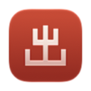
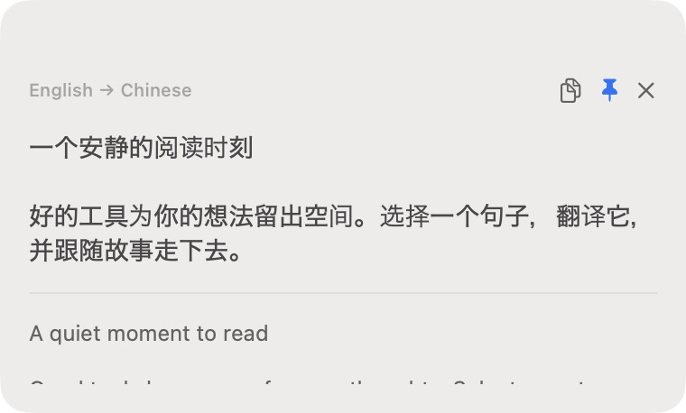
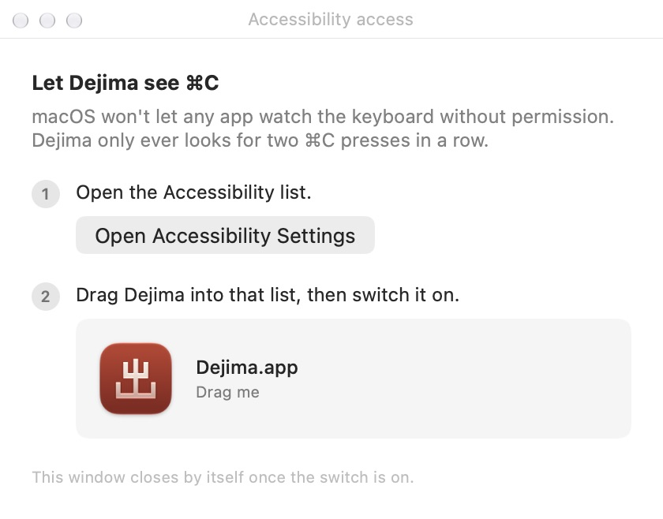
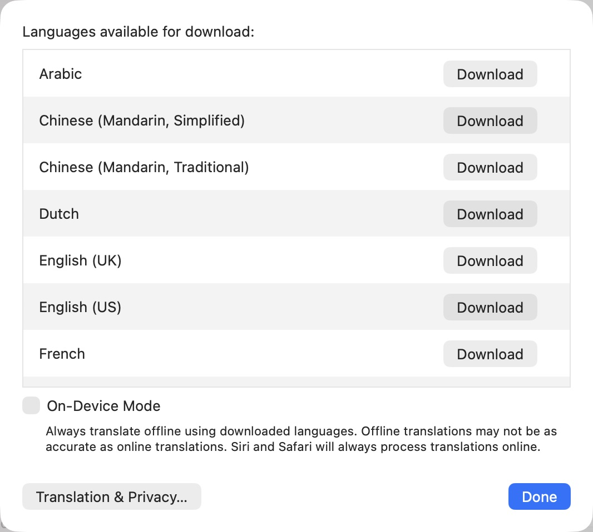

# Dejima

**Mac 本地翻译，双按 ⌘C 就能用。**

选中文字，连按两次 ⌘C，译文出现在鼠标旁。Dejima 不依赖应用的右键翻译菜单，也不用切换应用；所需模型准备好后即可离线使用。

[English](README.en.md) · [日本語](README.ja.md) · [한국어](README.ko.md)

*Dejima v0.2.8，英语界面。*

**[下载 Dejima](https://github.com/AIChemist-Nuki/dejima/releases/latest)** · macOS 15 或更新版本

## 三步开始

### 1. 安装并授权

打开下载的 DMG，选择与你的系统对应的文件夹：「macOS 15 到 25」或「macOS 26 或更新」。将 `Dejima.app` 拖到 Applications 后再启动。

按应用引导打开系统设置的辅助功能列表，将 Dejima 拖入列表并开启权限。授权成功后，引导会自动关闭。

### 2. 准备语言

Dejima 常驻菜单栏，没有 Dock 图标或主窗口。点击菜单栏图标，在「译成」和「如果已经是，就译成」中选择常用的两种语言。

如果翻译时提示缺少语言，点「查看语言模型…」打开系统设置的 **Language & Region**，再点 **Translation Languages…**，下载原文和译文所需的语言。如果已经能正常翻译，就无需额外下载。

*系统的翻译语言下载列表，英语界面。*

### 3. 选中，⌘C，⌘C

在网页或文档中选中一段可复制的文字，按住 ⌘，快速按两下 C。译文出现在鼠标旁；点浮窗外或按 Esc，即可继续阅读。

## 用得顺手

- **自动切换语言。** 原文是主语言时译为备用语言，其他情况译为主语言。默认分别为简体中文和日语；短文本可能识别不准。
- **复制与固定。** 点复制按钮复制译文，点图钉可让浮窗在点击外部时保持打开。Esc 仍可关闭。
- **额外润色。** 「用 Apple Intelligence 润色」会对初译再处理一次，默认关闭，仅在 macOS 26 或更新版本且模型可用时显示。润色失败时保留初译。
- **界面语言。** 跟随系统语言，支持简体中文、英语、日语和韩语，其他语言使用英语。

参见[翻译工具对比](docs/Comparison.md)（英文）。

连按两次 ⌘C 后没有反应？

确认文字可以正常复制、当前运行的 Dejima 已获辅助功能权限，且菜单中的监听没有暂停。若提示缺少语言模型，先通过「查看语言模型…」完成下载，再复制一次。

## 隐私

翻译和润色在本机完成。下载语言模型需要联网。

检查更新会访问 GitHub，不发送翻译内容、使用记录或应用生成的身份标识。自动检查默认关闭；开启后，若距上次成功检查已满 24 小时，会在启动时检查。失败后可能在下次启动时重试。

## 关于这个名字

Dejima 得名于长崎的[出岛](https://nagasakidejima.jp/history/)。江户时代，这座人工岛是日本与西欧贸易、知识与文化交流的窗口。

## 开发

构建要求、两个版本的差异和打包步骤见[开发文档](docs/Development.md)（英文）。

MIT 许可证，见 [LICENSE](LICENSE)。
